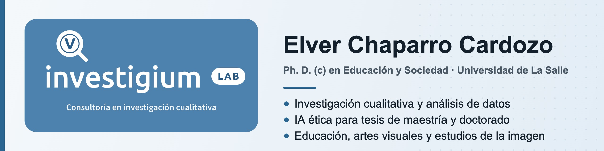

  

  
  
  
  

## Sobre mí

Investigador en ciencias de la educación, artes visuales y estudios de la imagen, y analista de datos cualitativos en Tunja (Boyacá, Colombia). Desde **Investigium Lab** diseño herramientas abiertas para que estudiantes de maestría y doctorado planeen su investigación con rigor y usen la inteligencia artificial de forma ética, con criterio propio y sin delegar el pensamiento.

## Herramientas destacadas

<table>
<tr>
<td width="50%" valign="top">

### [Ruta de investigación con IA](https://investigium.github.io/ruta-investigacion-ia/)
Caja de herramientas gratuita para planear una tesis en siete pasos: proceso, matriz de coherencia, revisión de literatura (PRISMA), mapa, cronograma, resumen y rúbrica. Todo queda en el navegador y se descarga en Word.

</td>
<td width="50%" valign="top">

### [Libro de prompts · Matriz de coherencia](https://investigium.github.io/libro-prompts-matriz/)
Diecinueve fichas guiadas para construir la matriz de coherencia con IA, con mapa interactivo del proyecto, cronograma tipo Gantt (modelo MinCiencias) e informe en Word.

</td>
</tr>
<tr>
<td width="50%" valign="top">

### [Seminario de trabajo de grado · UPTC](https://elvervisual.github.io/seminario-trabajo-de-grado-UPTC/)
Portal del seminario de la Maestría en Educación de la UPTC: sesiones, recursos y entregas.

</td>
<td width="50%" valign="top">

### [Laboratorio de análisis cualitativo](https://elvervisual.github.io/qualitative-analysis/)
Tablero para comprender modelos de análisis cualitativo, creado para la Maestría en Educación de la UPTC.

</td>
</tr>
<tr>
<td width="50%" valign="top">

### [Análisis fenomenológico](https://github.com/elvervisual/MOOC-analisis-fenomenologico)
Taller de análisis de datos cualitativos desde una perspectiva fenomenológica (también en [versión Streamlit](https://github.com/elvervisual/MOOC-analisis-fenomenologico-streamlit)).

</td>
<td width="50%" valign="top">

### [Jardín digital](https://elver-chaparro-lab.vercel.app)
Notas, ideas y materiales en construcción sobre investigación, educación e imagen.

</td>
</tr>
</table>

## Líneas de trabajo

- **Investigación cualitativa:** fenomenología, análisis temático, codificación y triangulación.
- **IA en el posgrado:** prompts con propósito, verificación de fuentes, alcances, límites y ética.
- **Educación y artes visuales:** estudios de la imagen, educación artística y cultura visual.

## Con qué trabajo

  
  
  
  
  
  
  

## Mentorías y consultorías

¿Está escribiendo su proyecto de maestría o doctorado? Acompaño la formulación, la matriz de coherencia, el diseño metodológico y el análisis cualitativo. Escríbame a **[investigium.lab@gmail.com](mailto:investigium.lab@gmail.com)**.

Investigium Lab · Consultoría en investigación cualitativa · Tunja, Colombia

